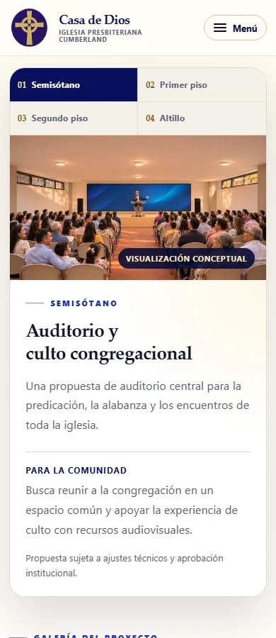
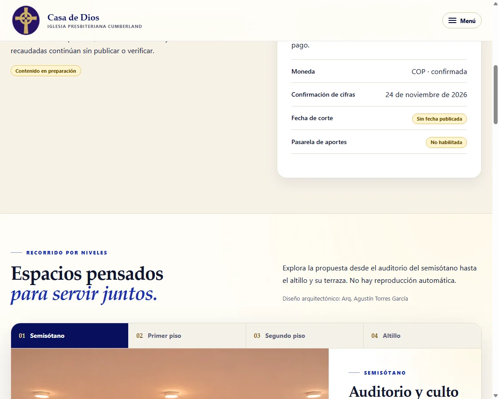
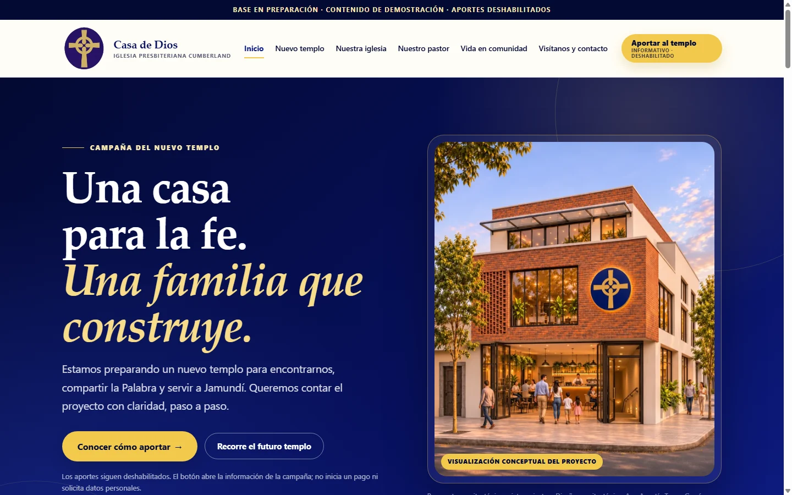

# Evidencia visual · Proyecto arquitectónico

Capturas generadas el 24 de noviembre de 2026 sobre la construcción de
producción local. Se revisaron desbordamiento horizontal, carga de imágenes,
composición responsive y permanencia de los avisos de propuesta conceptual.

| Ancho verificado | Vista | Resultado |
| ---: | --- | --- |
| 390 px | Recorrido por niveles | Dos columnas de pestañas, contenido legible y sin desbordamiento |
| 1125 px | Encabezado y recorrido | Cuatro pestañas visibles, distribución de imagen y texto conservada |
| 1440 px | Portada | Hero, fachada conceptual, acciones y aviso de aportes deshabilitados visibles |

## 390 px

## 1125 px

## 1440 px

Además de las capturas, la verificación con teclado confirmó:

- cambio de nivel con flechas y foco sobre la pestaña activa;
- apertura de una imagen de galería con `Enter`;
- cierre del diálogo con `Escape` y retorno del foco al botón de origen;
- ausencia de reproducción automática.
